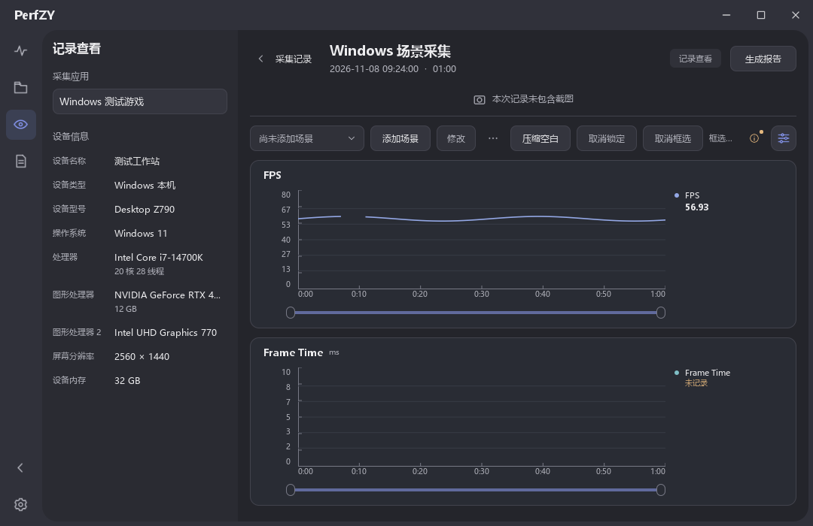
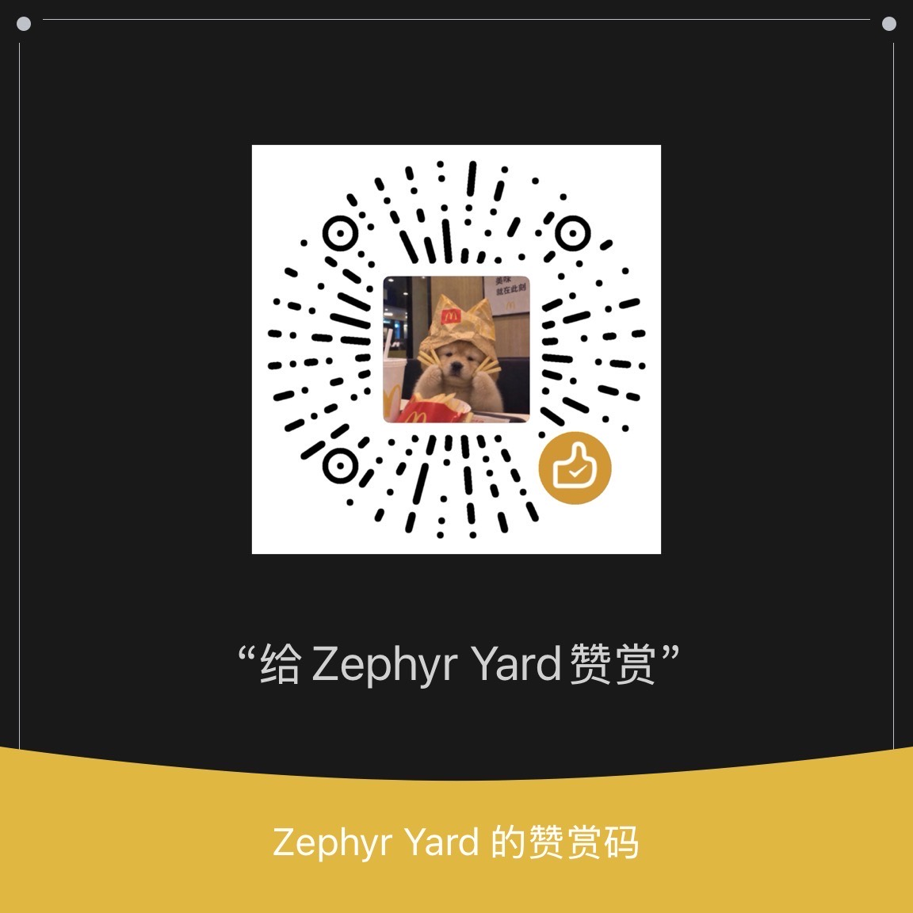

# PerfZY

PerfZY 是一个 Windows 桌面性能采集工具，支持 Windows 本机、Android 和 iOS 应用。它把实时指标、截图和场景标记放在同一条时间轴上，测试完成后可回看曲线、比较记录或导出 HTML 报告。



## 功能

- 实时查看 FPS、帧耗时、CPU、内存和 GPU 等指标。可采集的指标随平台、设备和应用而变化。
- 采集时标记场景并定时截图。打开历史记录后，可框选时间段、编辑场景或剪辑记录。
- 合并或对比历史记录，导出可在浏览器中打开的 HTML 报告。
- 手动把选中的采集记录发往自定义服务，也可用 Python SDK 将采集接入测试脚本。

## 安装和启动

下载或克隆源码，在 **Windows x64** 上安装 **Python 3.11 或更新版本**。在源码目录打开 PowerShell，执行以下命令。

```powershell
py -3 -m venv .venv
.\.venv\Scripts\python.exe -m pip install -r requirements.txt
```

双击 `START_PERFZY.bat` 启动。按需要准备对应平台的采集组件。

| 目标平台 | 首次连接 |
| --- | --- |
| Windows 本机 | 安装 PresentMon CLI 2.5.1，将 `PresentMon.exe` 放在 `tools/`，或把 CLI 所在目录加入 PATH。按提示授予帧采集权限。 [下载 PresentMon CLI](https://github.com/GameTechDev/PresentMon/releases/tag/v2.5.1) |
| Android | 解压 Android SDK Platform-Tools，把 `platform-tools` 目录加入 PATH。在设备上启用 USB 调试并确认授权。 [下载 Platform-Tools](https://developer.android.com/tools/releases/platform-tools) |
| iOS | Windows 上安装 Apple Devices，通过 USB 连接，按提示信任电脑并启用所需的开发者模式。 [Apple Devices 使用指南](https://support.apple.com/guide/devices-windows/welcome/windows) |

在「设置 → 连接诊断」可检查设备、采集组件和权限。

## 第一次采集

1. 打开「常规测试」，选择设备和应用。用右下角的「性能指标」调整采集项目。
2. 点「开始」。测试过程中可标记场景，点「停止」后保存记录。
3. 在「采集记录」点「查看」回看曲线和截图，也可以生成报告。历史报告集中在「HTML 报告」。

采集记录和导出报告分别保存在软件目录的 `data/` 和 `exports/`。

## 自定义上传

在「设置 → 上传设置」填写接收地址和服务的 Token。地址会保存在本机，Token 在本次运行内有效。进入「采集记录」，选中一条记录并点「上传记录」，确认后发送设备、应用、指标时间序列和场景数据。截图按需勾选。接收端返回报告链接时，可从回执打开报告。 [自定义上传接口](docs/自定义上传接口.md)

## Python SDK

通过 Python 脚本进行采集、保存、合并和报告导出，也可以将采集嵌入 pytest。 [Python SDK 使用说明](docs/PythonSDK使用说明.md) · [示例代码](examples)

## 反馈

如果遇到问题，可以在 Gitee 的 Issues 提交复现步骤，并注明系统版本、目标平台、应用类型和缺失的指标。日志和截图可以先去掉账号、设备编号等个人信息。

## 赞赏

如果 PerfZY 帮你节省了测试时间，欢迎用微信扫码自愿赞赏。点击图片可查看原图。

<a href="docs/images/wechat-sponsor.jpg"></a>

## 许可

PerfZY 源码采用 GPL-3.0-or-later，第三方组件保留各自的许可与版权声明。 [GPLv3 正文](LICENSE) · [pymobiledevice3](https://github.com/doronz88/pymobiledevice3) · [Qt for Python](https://doc.qt.io/qtforpython-6/)

